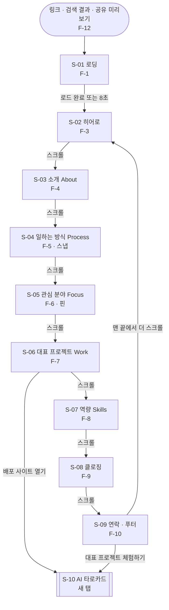
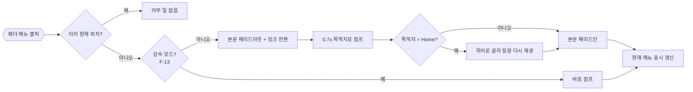
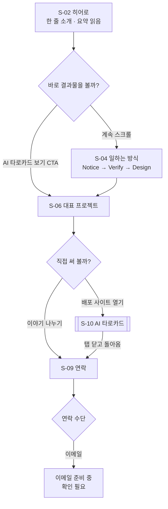
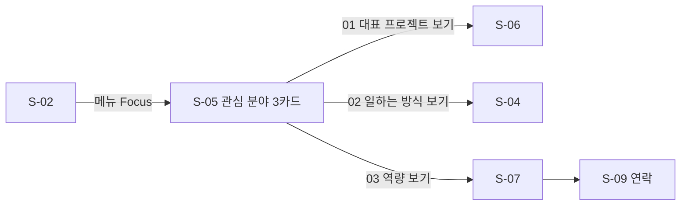
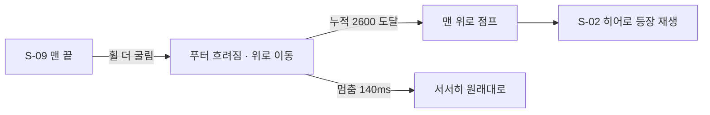
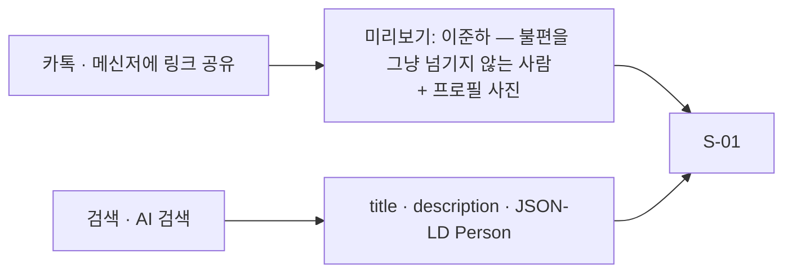

# PORTFOLIO_03 — 유저플로우

| 항목 | 내용 |
|---|---|
| 문서 | PORTFOLIO_03_유저플로우 |
| 버전 · 날짜 | v1.0 · 2026-11-26 |
| 이전 문서 | PORTFOLIO_01_PRD (F-1~F-14) · PORTFOLIO_02_기능명세서 |
| 다음 문서 | PORTFOLIO_04_와이어프레임 (S-01~S-10) |
| 표기 | 노드 이름에 화면 번호(S-xx)와 기능 번호(F-x)를 함께 적는다 |

---

## 1. 화면 목록

| 화면 ID | 화면 | 앵커 | 관련 기능 |
|---|---|---|---|
| S-01 | 로딩 | — | F-1 |
| S-02 | 히어로 | `#home` | F-2, F-3, F-11 |
| S-03 | 소개(About) | `#manifesto` | F-4 |
| S-04 | 일하는 방식(Process) | `#process` | F-5 |
| S-05 | 관심 분야(Focus) | `#services` | F-6 |
| S-06 | 대표 프로젝트(Work) | `#work` | F-7 |
| S-07 | 역량(Skills) | `#skills` | F-8 |
| S-08 | 클로징 메시지 | — | F-9 |
| S-09 | 연락 · 푸터 | `#contact` | F-10 |
| S-10 | AI 타로카드 배포 사이트 (외부, 새 탭) | figma.site | F-7 |

공통: F-2 내비게이션 · F-11 사운드 · F-12 SEO · F-13 접근성 · F-14 반응형은 모든 화면에 적용.

---

## 2. 전체 흐름 (첫 방문 → 스크롤)

## 3. 메뉴 이동 흐름 (F-2)

| 메뉴 | 목적지 화면 |
|---|---|
| Home | S-02 |
| About | S-03 |
| Process | S-04 (첫 패널 끝) |
| Focus | S-05 (데스크톱: 카드 3개 다 보인 상태) |
| Work | S-06 |
| Contact | S-09 (페이지 맨 끝) |

## 4. 목적별 흐름

### 4-1. U-1 채용 담당자 — "이 사람이 PM 직무에 맞나?" (3분)

### 4-2. U-2 협업자 — "어떤 분야에 관심 있지?"

### 4-3. 끝까지 본 사용자 — 루프 (F-10)

### 4-4. 공유 · 검색으로 유입 (F-12)

## 5. 예외 흐름

| 상황 | 결과 |
|---|---|
| 글꼴 · 텍스처 로드 실패 | 8초 후 로더 종료, 시스템 글꼴로 표시 |
| 배경 음원 로드 실패 | 사운드 버튼이 나타나지 않음 (F-11 숨김) |
| 감속 모드 사용자 | 모든 움직임 없이 즉시 표시, 메뉴는 바로 점프 |
| 키보드 사용자 | Tab 첫 번째 = 본문 바로가기, 헤더에 포커스 시 숨김 해제 |
| 외부 배포 사이트가 열리지 않음 | 새 탭에서만 실패, 포트폴리오는 영향 없음 |
